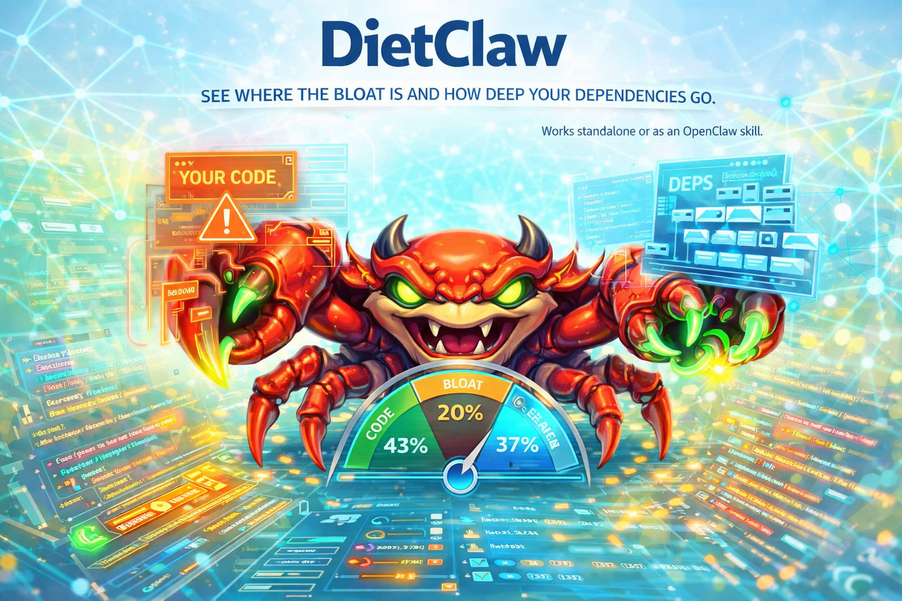

# Dietclaw

[](https://www.npmjs.com/package/dietclaw)
[](https://github.com/psandis/dietclaw/actions/workflows/ci.yml)

Codebase health monitor. See where the bloat is, how deep your dependencies go, and what's actually your code vs what you're carrying. Works standalone or as an OpenClaw skill.

<p align="center">
  
</p>

## What It Does

- separates your code from everything else (dependencies, assets, generated files, configuration)
- shows the source-to-bloat ratio
- counts transitive dependencies and shows how many packages get installed
- detects large files, long files, and duplicate files
- analyzes outdated packages, unused dependencies, heaviest packages, and version conflicts
- compares multiple projects side by side with `--each`
- tracks project health over time with `--save` and `trend`
- `--json` flag on all commands for agents and scripts
- runs on macOS, Linux, and Windows

## Requirements

- Node.js 22.12 or newer (24 LTS recommended)
- pnpm 12 or newer (only for building from source)
- macOS, Linux, or Windows 10/11

Dietclaw stores history in SQLite through [better-sqlite3](https://github.com/WiseLibs/better-sqlite3), which ships prebuilt binaries for current Node.js versions on macOS, Linux, and Windows (x64 and arm64). If no prebuilt binary matches your platform, npm compiles it from source, which needs a C++ toolchain:

| Platform | Toolchain |
|---|---|
| macOS | `xcode-select --install` |
| Linux | `build-essential` and `python3` |
| Windows | Visual Studio Build Tools with the "Desktop development with C++" workload |

## Install

### From npm

```bash
npm install -g dietclaw
dietclaw --help
```

### From source

macOS / Linux:

```bash
git clone https://github.com/psandis/dietclaw.git
cd dietclaw
pnpm install
pnpm build
pnpm cli --help
```

Windows (PowerShell):

```powershell
git clone https://github.com/psandis/dietclaw.git
Set-Location dietclaw
pnpm install
pnpm build
pnpm cli --help
```

When running from source, use `pnpm cli <command>` in place of `dietclaw <command>`.

## Quick Start

```bash
dietclaw scan                      # scan current directory
dietclaw scan ../myproject         # scan another project
dietclaw scan ~/Projects --each    # compare all projects in a folder
dietclaw deps                      # dependency analysis
dietclaw scan --save               # save a snapshot
dietclaw trend                     # view history
```

Paths work the same on Windows: `dietclaw scan C:\Projects\myapp` or `dietclaw scan ..\myapp`.

## CLI

### Scan a project

```
dietclaw scan

  Project Health Report
  ~/Projects/dietclaw

  Weight
    Total        2.5 MB
    Source code  84.1 KB  (3.3%)

  Breakdown

┌─────────────────┬─────────┬───────┬───────┐
│ Category        │ Size    │ Files │ Share │
├─────────────────┼─────────┼───────┼───────┤
│ Assets          │ 2.4 MB  │ 1     │ 93.5% │
│ Source code     │ 84.1 KB │ 19    │ 3.3%  │
│ Generated files │ 53.6 KB │ 1     │ 2.1%  │
│ Other files     │ 28.8 KB │ 4     │ 1.1%  │
│ Configuration   │ 2.3 KB  │ 4     │ 0.1%  │
└─────────────────┴─────────┴───────┴───────┘

  Dependencies
    Direct       7 production + 9 development
    Installed    62 packages (198.4 MB)

  Languages

┌────────────┬───────┬───────┬───────┐
│ Language   │ Lines │ Files │ Share │
├────────────┼───────┼───────┼───────┤
│ TypeScript │ 2,805 │ 19    │ 51.7% │
│ YAML       │ 1,696 │ 2     │ 31.3% │
│ Markdown   │ 471   │ 2     │ 8.7%  │
│ JSON       │ 97    │ 3     │ 1.8%  │
└────────────┴───────┴───────┴───────┘

  Long Files (1)
  Source files exceeding the line threshold

┌───────────────────┬───────┐
│ File              │ Lines │
├───────────────────┼───────┤
│ src/lib/format.ts │ 360   │
└───────────────────┴───────┘

  Large Files (1)
  Files exceeding the size threshold

┌─────────────────────┬────────┐
│ File                │ Size   │
├─────────────────────┼────────┤
│ assets/dietclaw.png │ 2.4 MB │
└─────────────────────┴────────┘
```

Notes:

- `--limit <n>` controls how many large, long, and duplicate files to show (default: `10`)
- binary files (detected by content, not extension) are counted for size but not for lines
- file paths are always shown with forward slashes, on every platform
- language share is relative to all text lines, so files without a mapped language (such as `LICENSE`) make the total less than 100%

### Compare multiple projects

```
dietclaw scan ~/Projects --each

  Project Comparison

┌────────────────────┬─────────────┬──────────┬──────────────┐
│ Project            │ Source code │ Assets   │ Dependencies │
├────────────────────┼─────────────┼──────────┼──────────────┤
│ dietclaw           │ 84.1 KB     │ 2.4 MB   │ 198.4 MB     │
│ driftclaw          │ 56.6 KB     │ 2.6 MB   │ 151.8 MB     │
│ dustclaw           │ 36.5 KB     │ 2.8 MB   │ 210.4 MB     │
│ feedclaw           │ 37.2 KB     │ 1.8 MB   │ 282.7 MB     │
└────────────────────┴─────────────┴──────────┴──────────────┘
```

(Excerpt: rows for other projects in the folder are omitted.)

Notes:

- detects subprojects by looking for project markers (`package.json`, `Cargo.toml`, `go.mod`, etc.)
- project markers are configurable in `data/defaults.jsonc`
- `--save` works with `--each` and saves one snapshot per project

### Dependency analysis

```
dietclaw deps --limit 8

  Dependency Analysis
  ~/Projects/dietclaw

  Outdated Packages
  All packages are up to date

  Unused Dependencies
  All dependencies are imported

  Heaviest Packages (top 8)

┌─────────────────────────────────────┬─────────┐
│ Package                             │ Size    │
├─────────────────────────────────────┼─────────┤
│ @biomejs/cli-darwin-arm64           │ 55.8 MB │
│ @typescript/typescript-darwin-arm64 │ 26.2 MB │
│ better-sqlite3                      │ 26.0 MB │
│ @rolldown/binding-darwin-arm64      │ 16.1 MB │
│ esbuild                             │ 10.2 MB │
│ @esbuild/darwin-arm64               │ 10.1 MB │
│ lightningcss-darwin-arm64           │ 8.2 MB  │
│ oxc-parser                          │ 2.8 MB  │
└─────────────────────────────────────┴─────────┘
```

When a project has packages resolved at more than one version, `deps` lists them with what needs each version. From [Feedclaw](https://github.com/psandis/feedclaw):

```
dietclaw deps ~/Projects/feedclaw --limit 5

  Version Conflicts (4)
  These packages exist multiple times in your project at different versions.
  This happens when your dependencies each require a different version of the same package.

┌───────────────────────┬───────────────────┬────────────────────────┐
│ Package               │ Installed version │ Needed by              │
├───────────────────────┼───────────────────┼────────────────────────┤
│ @esbuild/darwin-arm64 │ 0.27.4            │ esbuild                │
│ @esbuild/darwin-arm64 │ 0.28.2            │ esbuild                │
│ commander             │ 4.1.1             │ sucrase                │
│ commander             │ 15.0.0            │ direct                 │
│ esbuild               │ 0.27.4            │ bundle-require +2 more │
│ esbuild               │ 0.28.2            │ tsx                    │
│ tinyexec              │ 0.3.2             │ tsup                   │
│ tinyexec              │ 1.3.0             │ vitest                 │
└───────────────────────┴───────────────────┴────────────────────────┘
```

(Excerpt: the sections above Version Conflicts are omitted.)

Notes:

- `--limit <n>` controls how many items per section (default: `20`)
- outdated packages come from `npm outdated`; if npm is missing or the check fails, the report says "Could not check" instead of claiming everything is up to date
- unused dependencies are found by parsing every JavaScript and TypeScript file (extensions listed in `moduleExts` in `data/defaults.jsonc`) and collecting `import`, `export ... from`, `import()`, `require()`, and TypeScript `import x = require()` references. Only static strings count, so `require(variable)` is not resolved, and packages used only from config files, npm scripts, or non-JS files are reported as unused
- version conflicts are read from `pnpm-lock.yaml` (lockfile format v9, pnpm 9 and later) and limited to packages that install on the current OS and CPU; other package managers are not analyzed for conflicts
- heaviest packages are measured on disk in `node_modules`; with a pnpm lockfile, store entries the lockfile no longer references are skipped
- problems that limit the analysis, such as an unsupported lockfile version, are shown as warnings at the top of the report

### Track changes over time

Save snapshots with `--save` and view the trend:

```bash
dietclaw scan --save              # save a snapshot
dietclaw trend                    # view history
```

```
dietclaw trend

  Project Trend
  ~/Projects/dietclaw

  History (2 snapshots)

┌─────────────────────┬───────┬───────┬─────────────┬────────┬──────────┬──────────────┐
│ Timestamp           │ Files │ Lines │ Source code │ Total  │ Packages │ Dependencies │
├─────────────────────┼───────┼───────┼─────────────┼────────┼──────────┼──────────────┤
│ 2026-10-11 19:11:36 │ 23    │ 5,051 │ 62.1 KB     │ 2.5 MB │ 14       │ 197.3 MB     │
│ 2026-10-11 19:09:50 │ 23    │ 4,968 │ 62.1 KB     │ 2.5 MB │ 14       │ 202.2 MB     │
└─────────────────────┴───────┴───────┴─────────────┴────────┴──────────┴──────────────┘

  Change
    Total        +3.5 KB
    Source code  +12 B
    Files        no change
    Lines        +83
```

Notes:

- `--limit <n>` controls how many snapshots to show (default: `20`)
- the change summary compares the newest and oldest snapshot shown
- snapshots are matched by the project's real path, so symlinked paths and Windows drive letter casing map to the same history

## Storage

Snapshots are stored in a local SQLite database. Nothing leaves your machine.

| Platform | Default location |
|---|---|
| macOS | `~/.dietclaw/history.db` |
| Linux | `~/.dietclaw/history.db` |
| Windows | `%USERPROFILE%\.dietclaw\history.db` |

Override the folder with the `DIETCLAW_HOME` environment variable:

```bash
# macOS / Linux
export DIETCLAW_HOME="$HOME/dietclaw-data"
```

```powershell
# Windows PowerShell
$env:DIETCLAW_HOME = "$HOME\dietclaw-data"
```

```bat
:: Windows cmd
set DIETCLAW_HOME=%USERPROFILE%\dietclaw-data
```

To reset history, delete the `history.db` file.

## Configuration

All classification rules live in `data/defaults.jsonc`, a JSONC file with inline comments explaining every option. No code changes needed to:

- add new languages or file extensions
- change what counts as source code, assets, data, or binaries
- adjust thresholds for large files (default: 500 KB) and long files (default: 300 lines)
- add directories to the ignore list
- add project markers for `--each` detection

An invalid `defaults.jsonc` stops dietclaw with an error naming the file and the position of the problem.

## Agent Integration

All commands support `--json` for structured output:

```bash
dietclaw --json scan
dietclaw --json deps
dietclaw --json scan ~/Projects --each
dietclaw --json trend
```

In `deps` output, `outdated` is `null` when the check could not run, and an array (possibly empty) otherwise. `warnings` lists problems that limited the analysis.

Errors are written to stderr with exit code `1`.

### OpenClaw Skill

Once installed globally (`npm install -g dietclaw`), add a `SKILL.md` to your workspace:

```markdown
---
name: dietclaw
description: Codebase health monitor. Find bloat, complexity, and dependency weight.
version: 1.0.0
requires_binaries:
  - dietclaw
---

When the user asks about project health, size, bloat, or dependencies, use the `dietclaw` CLI:

- To scan a project: `dietclaw --json scan`
- To analyze dependencies: `dietclaw --json deps`
- To compare projects: `dietclaw --json scan ~/Projects --each`
- To view trend: `dietclaw --json trend`
```

## Roadmap

- `dietclaw monitor`: runtime performance monitoring (memory, CPU)
- CI-friendly exit codes and thresholds
- version conflicts for npm (`package-lock.json`) and Yarn lockfiles

## Development

```bash
git clone https://github.com/psandis/dietclaw.git
cd dietclaw
pnpm install
pnpm build
pnpm test
pnpm lint
pnpm typecheck
pnpm cli --help
```

CI runs lint, type checking, tests, build, and a CLI smoke test on macOS, Linux, and Windows with Node.js 22 and 24.

## Changelog

See [CHANGELOG.md](CHANGELOG.md).

## Related

- 🦀 [Dustclaw](https://github.com/psandis/dustclaw): Find out what is eating your disk space
- 🦀 [Driftclaw](https://github.com/psandis/driftclaw): Deployment drift detection across environments
- 🦀 [Feedclaw](https://github.com/psandis/feedclaw): RSS/Atom feed reader and AI digest builder
- 🦀 [OpenClaw](https://github.com/openclaw/openclaw): The open claw ecosystem

## License

See [MIT](LICENSE)
